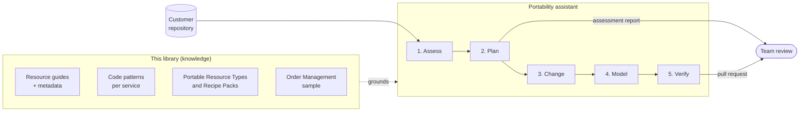

# Proposal: portability assistant

An AI assistant that helps a team port an existing Azure application to Azure Local. It reads the
team's code, finds the Azure services it depends on, and uses this library's guides, code
patterns and Recipes to plan and make the changes. People review and approve every change.

Status: **Proposal**. The next step is a proof of concept (POC) on one existing application.

## Problem

Teams that need their Azure application to keep running on Azure Local, for business continuity
or sovereignty, face the same questions for every application:

- **What does the application depend on?** Azure dependencies are spread across code, SDK
  packages, configuration, infrastructure templates and pipelines. Finding them all is manual and
  easy to get wrong.
- **What replaces each service on Azure Local, and what's lost?** The answer is in this library's
  resource guides, but a team has to find the right guide, read it and apply it to their own code.
- **What code has to change?** Swapping an SDK (for example Service Bus to RabbitMQ, or Blob
  Storage to S3) or an identity model (workload identity to Keycloak tokens) touches many files.
  The guides explain the pattern; applying it is repetitive work.
- **How is it deployed on both platforms?** The application needs a Radius application definition
  and a Recipe Pack for each platform. Writing these from scratch takes Radius knowledge most teams
  don't have yet.

Today a team does all of this by hand, one application at a time. It's slow, and the result
depends on who does it.

Existing tools cover part of it. The [Radius integration for the GitHub Copilot
app](https://docs.radapp.io/integrations/github-copilot-app/) models an application and deploys
it, but it doesn't change code, doesn't know what carries over to Azure Local, and its preview
deploys to Azure only.

## Goals

- Produce a **portability assessment** for an existing repository: each Azure dependency, its
  Azure Local alternative, how portable it is, and what has to change.
- **Propose code and configuration changes** that follow the patterns in this library, as a
  reviewable branch or pull request.
- Generate a **Radius application definition** that uses this library's portable Resource Types,
  so the application deploys with our Azure and Azure Local Recipe Packs.
- Ground every answer in this library, and link each finding to the guide it came from.

## Non-goals

- Fully automatic porting. A person reviews and approves every change.
- Data migration, cut-over and failover runbooks. These are separate, later work.
- Services that this library has no guide for. The assistant reports them as gaps rather than
  guessing.
- Replacing Radius tooling. Where Radius already models or deploys, the assistant uses it.

## How it works

The assistant has two parts: the **knowledge** that already lives in this repository, and the
**assistant** that applies it to a customer's code.

### The knowledge (this repository)

| Piece | What it gives the assistant | State today |
|---|---|---|
| Resource guides (`resources/<slug>/`) | The alternatives, how portable each service is, what changes, what's lost | Seven guides in review |
| Guide metadata | A short block at the top of each guide: the Azure resource, the SDK packages and resource types that signal it, the alternatives, portability class and availability. Lets the assistant match code to a guide without reading every guide | **New** |
| Code patterns (`resources/<slug>/examples/`) | One small interface with an Azure and an Azure Local version, per service. Small examples are reused far more reliably than a whole app | **New** (folder already planned) |
| Portable Resource Types and Recipe Packs | What the application definition should use, and how each platform provides it | In the Order Management sample |
| Order Management sample | A complete, working reference when a pattern needs more context | In review |

### The assistant

Built on GitHub Copilot's existing extension points, so it runs in VS Code or the Copilot CLI with
no new product to install:

- a **custom agent** (`portability`) that runs the steps below and knows to stop for review;
- **skills**, one per step, that read the guides and patterns from this repository;
- **instructions** that tell it to cite a guide for every finding and to report a gap rather than
  guess.

The steps:

1. **Assess.** Scan the repository: SDK packages, connection settings, infrastructure templates
   (Bicep, ARM, Terraform), pipelines. Match each Azure dependency to a guide using the guide
   metadata.
2. **Plan.** Write an assessment report (below) and stop for the team to choose an alternative
   and availability for each dependency.
3. **Change.** Apply the code patterns: add the interface, the Azure Local implementation and the
   configuration switch; replace the identity model where needed. Keep the Azure version working.
4. **Model.** Generate the Radius application definition with portable Resource Types and
   connections, ready for our Recipe Packs. Use Radius tooling for this where it fits.
5. **Verify.** Build and run the tests, list what still needs a person (for example data
   migration), and open a pull request with the changes and the report.

### The assessment report

One table per application, each row linked to a guide:

| Azure dependency | Found in | Azure Local alternative | Portability | What changes | Guide |
|---|---|---|---|---|---|
| Service Bus | `Azure.Messaging.ServiceBus`, `main.bicep` | RabbitMQ | Adapter required | Messaging adapter, Keycloak credentials | Service Bus guide |
| Blob Storage | `Azure.Storage.Blobs` | SeaweedFS (S3) | Adapter required | Storage adapter, S3 keys | Storage account guide |
| Cosmos DB | `Microsoft.Azure.Cosmos` | No guide yet | Gap | Needs a person | None |

## Why not just point a model at the library?

A customer can already open their repository in VS Code, pick a model and give it this library as
input. The assistant doesn't replace that model: it runs on whichever model the customer picks.
What it adds is packaging and guardrails:

| | Model with the library as input | Portability assistant |
|---|---|---|
| Finding the right guide | Reads or searches the whole library; may miss a guide or fall back on general knowledge | Guide metadata maps SDK packages and resource types straight to the right guide |
| Workflow | Depends on the prompt; each person asks differently | Same steps every time, with a stop for review after the plan |
| Grounding | May mix our patterns with its own ideas | Cites a guide for every finding; reports a gap instead of guessing |
| Output | Free-form, hard to compare across applications | Fixed report format; one pull request per service |
| Code changes | Works out the pattern from a whole sample app | Copies small, tested code patterns |
| Improvements | Every customer writes their own prompts | Fixed once in the agent and skills, for everyone |

Most of the value is in the knowledge, not the agent. Guide metadata and code patterns help both
ways of working. The agent adds consistency, guardrails and less effort for the customer. If a
model with a well-structured library gets close to the assistant's results, the agent should stay
a thin layer. The proof of concept measures this.

## How a customer would use it

1. **Open their repository** in VS Code (or the Copilot CLI) and add the portability assistant
   from this library.
2. **Ask for an assessment:** "Assess this repository for Azure Local." Review the report with the
   team and choose an alternative and availability for each dependency.
3. **Ask for the changes:** "Port the messaging and storage to Azure Local." The assistant works on
   a new branch, one service at a time.
4. **Review and run.** Review the pull request, run the tests, and deploy to Azure first to check
   nothing broke, then to Azure Local with our Recipe Pack.
5. **Handle the gaps** the report lists by hand, or ask for a new guide in this library.

The assistant only reads the customer's repository and this library. If the customer can't send
code to a cloud AI service, the guides, patterns and report format still work by hand.

## Proof of concept

Run the assistant on **one existing application** that wasn't written with this library in mind.

- **Scope:** an application that uses at least two services with guides (for example Service Bus
  and Blob Storage) and one without (to test gap reporting). A public sample such as the
  [AKS Store Demo](https://github.com/Azure-Samples/aks-store-demo) is a candidate.
- **Build:** the custom agent, the assess and change skills, metadata for the guides the
  application needs, and code patterns for those services.
- **Compare two ways of working** on the same application and the same model:
  1. **Baseline:** the model with this library as input and a plain prompt, such as "Port this
     application to Azure Local using this library."
  2. **Assistant:** the custom agent and skills.
- **Measure, for both:**
  - Assessment: did it find every Azure dependency, and link the right guide? Any false findings?
  - Changes: do they build, do the tests pass, does the application run on Azure and on Azure
    Local? How much did a person have to fix?
  - Consistency: how much do the results differ between runs?
  - Effort: time to port, compared with by hand.
- **Decide:**
  - whether the guides are good enough to ground an assistant, and what's missing;
  - whether the agent adds enough over the baseline to grow it, or whether to invest mainly in
    guide metadata and code patterns.

## Risks and open questions

- **Coverage.** The assistant is only as good as the guides. Every service without a guide is a
  gap. Likely next guides: Redis, Cosmos DB, Event Hubs, Azure Functions, App Service, Front Door.
- **Languages.** The sample and patterns are .NET. Other languages need their own patterns.
- **Wrong changes.** AI can make plausible but wrong changes. Mitigations: small patterns, cite
  the guide, build and test before the pull request, and human review.
- **Sovereign customers** may not allow cloud AI on their code. Keep everything usable by hand.
- **Radius Copilot integration** is in preview and Azure-only. Should we contribute our Azure
  Local Recipe Pack and Resource Types so it can plan for Azure Local, and depend on it for
  modelling and deployment?
- **Distribution.** Ship the agent and skills inside this repository, or as a Copilot plugin?
