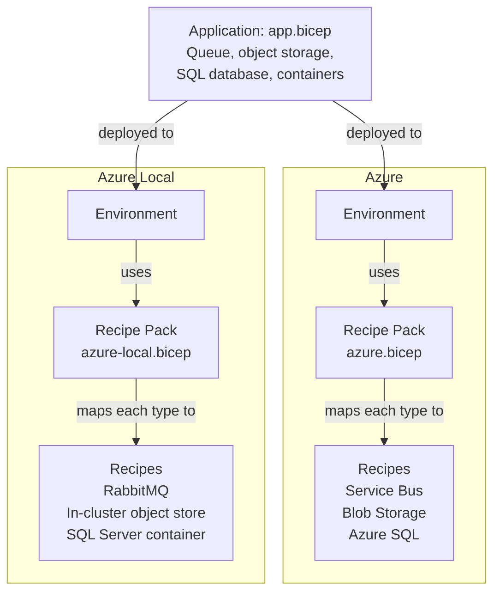

# Recipes and Recipe Packs

This repository uses [Radius](https://docs.radapp.io/concepts/) so the same application definition runs on Azure and on Azure Local. This page explains how an application uses Recipes and Recipe Packs, how the Order Management sample does it, and how to reuse the Recipes and Recipe Packs in this repository. For the concepts themselves, see the Radius documentation.

## The pieces

| Piece | What it is | Who owns it | Radius docs |
|---|---|---|---|
| **Resource Type** | What the application needs, without naming a product: a queue, object storage, a SQL database | Shared between app and platform | [Resource Types](https://docs.radapp.io/concepts/resource-types/) |
| **Recipe** | How one platform provides a Resource Type: for example Azure Service Bus on Azure, RabbitMQ on Azure Local | Platform team | [Custom Recipes](https://docs.radapp.io/extensibility/custom-recipes/) |
| **Recipe Pack** | The set of Recipes for one platform, with that platform's settings | Platform team | [Recipe Packs](https://docs.radapp.io/concepts/recipe-packs/) |
| **Environment** | Where an application is deployed; it points to one Recipe Pack | Platform team | [Environments](https://docs.radapp.io/concepts/environments/) |
| **Application** | The resources the app declares and the containers that use them | App team | [Applications](https://docs.radapp.io/concepts/applications/) |

## How an application uses them

1. **Declare Resource Types, not products.** The app asks for a queue, object storage or a database. It never names Service Bus, RabbitMQ or a storage account.
2. **Connect each container to the resources it uses.** Radius gives the container the resource's values as environment variables, named `CONNECTION_<NAME>_<PROPERTY>`. See [Connections](https://docs.radapp.io/applications/connections/).
3. **Read those values at startup and pick the client.** For example, a queue's `provider` value says whether to use the Service Bus or the RabbitMQ client. The app code has one implementation per provider, behind one interface.
4. **Leave platform settings to the Recipe Pack.** Identity, image registries, certificates and how the app is published are set per platform, not in the app definition.

The same application file then deploys to either environment. Only the environment, and so the Recipe Pack, changes.

## How the Order Management sample uses them

| Step | Where |
|---|---|
| The app declares a queue, object storage, a SQL database and two containers | [app.bicep](../samples/OrderManagementApp/deploy/app.bicep) |
| Radius has no queue type that covers both Service Bus and RabbitMQ, so the repository defines one | [messageQueues.yaml](../recipes/message-queue/messageQueues.yaml) |
| One Recipe per resource and platform | [recipes/](../recipes), as `<capability>/<platform>/<implementation>/` |
| One Recipe Pack per platform | [recipe-packs/](../recipe-packs): `azure.bicep`, `azure-local.bicep` |
| One environment per platform, each pointing to its pack | [deploy/environments/](../samples/OrderManagementApp/deploy/environments) |
| The deploy scripts publish the Recipes, deploy the pack and the environment, then the app | [scripts/deploy/](../samples/OrderManagementApp/scripts/deploy) |

The app reads its connection values in [Configuration](../samples/OrderManagementApp/src/OrderManagement.Shared/Configuration) and picks its clients in [DependencyInjection](../samples/OrderManagementApp/src/OrderManagement.Shared/DependencyInjection).

## Reuse the Recipes and Recipe Packs in your own app

The Recipes and Recipe Packs here are sample code. Review and adapt them to your environment, security requirements and standards before you use them.

1. **Get the files.** Clone this repository, or download the [recipes/](../recipes) and [recipe-packs/](../recipe-packs) folders.
2. **Register any custom Resource Types** your app uses, such as the queue type. Create it in Radius with [`rad resource-type create`](https://docs.radapp.io/reference/cli/rad_resource-type_create/), and generate its Bicep extension with [`rad bicep publish-extension`](https://docs.radapp.io/reference/cli/rad_bicep_publish-extension/) so your app file can use it. See [Resource Types](https://docs.radapp.io/extensibility/resource-types/).
3. **Publish the Recipes** to an OCI registry, such as Azure Container Registry, with [`rad bicep publish`](https://docs.radapp.io/reference/cli/rad_bicep_publish/). The Radius control plane pulls them from inside the cluster, so the registry must be reachable from there. On Azure Local, use a registry on site, such as the ACR connected registry, so deployments keep working offline. The sample's [publish-recipes.ps1](../samples/OrderManagementApp/scripts/deploy/publish-recipes.ps1) shows the naming the packs expect.
4. **Deploy a Recipe Pack** for each platform with your values: your registry, identities and network settings. Each pack's parameters are described in the file. Copy and edit a pack if you need different Recipes or settings. See [Managing Recipe Packs](https://docs.radapp.io/management/recipe-packs/).
5. **Create an environment** that points to the pack. See [Managing Environments](https://docs.radapp.io/management/environments/).
6. **Declare the Resource Types in your app** and connect your containers to them, as in steps 1 to 3 of [How an application uses them](#how-an-application-uses-them). Then deploy the app to each environment.

To add a platform or replace a product, write a new Recipe that returns the same values as the existing ones for that Resource Type, and add it to a new or existing Recipe Pack. The app doesn't change.
