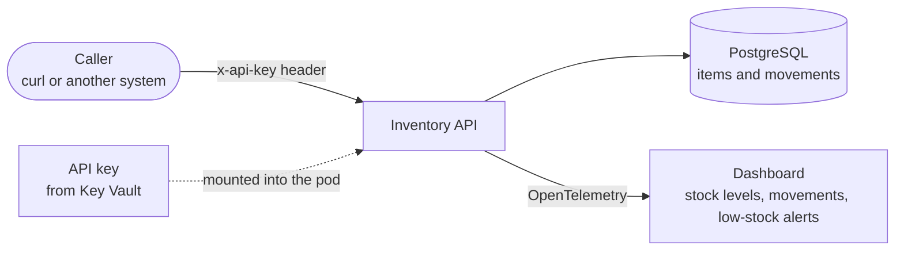

# Inventory API

> **Status:** this sample is being built. This README describes its design; the commands work once
> the code lands.

A small stock tracker for a site such as a store, warehouse or field depot. It has no user
interface: other systems call it, and people watch it on a dashboard. The same app runs on Azure and
on Azure Local, where it keeps tracking stock when the site loses its link to Azure.

It covers what the [Order Management App](../OrderManagementApp/README.md) doesn't: **PostgreSQL**,
**secrets from Key Vault** and **observability**.

## Architecture

Callers record stock coming in or going out. The API stores every movement in PostgreSQL, checks the
caller's API key, and warns when an item drops below its minimum.



| | Azure | Azure Local |
|---|---|---|
| Database | Azure Database for PostgreSQL flexible server | PostgreSQL container |
| App's sign-in to the database | Microsoft Entra workload identity | password, kept in a Kubernetes Secret |
| API key | Key Vault, mounted by the Secrets Store CSI driver | Key Vault, synced into the cluster by the Secret Store extension |
| Telemetry | Application Insights | Prometheus (metrics), Loki (logs) and Tempo (traces) in the cluster, viewed in Grafana |

The app reads the API key from a file and sends OpenTelemetry to the address the platform gives it,
so its code is the same on both. On Azure Local the key and the telemetry stay on site, so the app
keeps running and people keep seeing its dashboards without Azure. A changed key reaches the site
once the link is back.

Microsoft's own option for Azure Local, [Azure Monitor](https://learn.microsoft.com/azure/azure-monitor/containers/kubernetes-monitoring-enable-arc),
stores telemetry in Azure, so its dashboards stop when the link is down. The sample keeps telemetry
on site instead, with the open-source stack Grafana provides.

## API

| Request | Does |
|---|---|
| `GET /stock` | Lists every item with its level and minimum |
| `POST /stock/{item}` with `{"change": 10}` | Records stock in (positive) or out (negative); returns the new level |
| `PUT /stock/{item}/minimum` with `{"minimum": 5}` | Sets the level that triggers a low-stock warning |

Every request needs the `x-api-key` header.

## Prerequisites

**To run the app locally:**

- [.NET 9 SDK](https://dotnet.microsoft.com/download/dotnet/9.0)
- [Docker](https://docs.docker.com/get-docker/) or [Podman](https://podman.io/docs/installation)

**To deploy to Azure or Azure Local:** the same as the
[Order Management App](../OrderManagementApp/README.md). On Azure Local the app uses the
cluster that sample sets up.

## Run the app locally

```powershell
docker compose up --build
```

This starts the API, PostgreSQL and the same telemetry stack as on Azure Local (Prometheus, Loki,
Tempo and Grafana). The local API key is `local-dev-key`.

## Try it

```powershell
curl -H "x-api-key: local-dev-key" -H "Content-Type: application/json" -d '{"minimum": 5}' -X PUT http://localhost:8080/stock/generator/minimum
curl -H "x-api-key: local-dev-key" -H "Content-Type: application/json" -d '{"change": 10}' http://localhost:8080/stock/generator
curl -H "x-api-key: local-dev-key" -H "Content-Type: application/json" -d '{"change": -8}' http://localhost:8080/stock/generator
curl -H "x-api-key: local-dev-key" http://localhost:8080/stock
```

The third call drops the generator below its minimum, so the API logs a low-stock warning. Open
Grafana at http://localhost:3000 to see the stock level, the movements and the warning.

## Deploy to Azure

```powershell
azd auth login
az login
azd up
```

`azd up` creates the PostgreSQL server, the Key Vault with a generated API key, and Application
Insights, then deploys the app. It prints the app's address and how to read the API key.

## Deploy to Azure Local

Set up the platform with the [Order Management App](../OrderManagementApp/README.md)
first. Then, on the same management machine:

```powershell
./scripts/deploy.ps1 -Target AzureLocal
```

It adds the Secret Store extension and the telemetry stack to the cluster, then deploys the app with
PostgreSQL.

## Clean up

- **Locally:** `docker compose down`
- **Azure:** `azd down`
- **Azure Local:** `rad app delete inventory`

## Next steps

| | |
|---|---|
| [Order Management App](../OrderManagementApp/README.md) | the platform setup, Radius, Recipes and Recipe Packs |
| [Microsoft Entra authentication for PostgreSQL](https://learn.microsoft.com/azure/postgresql/flexible-server/concepts-azure-ad-authentication) | how the app signs in on Azure |
| [Key Vault Secret Store extension](https://learn.microsoft.com/azure/azure-arc/kubernetes/secret-store-extension) | Key Vault secrets on Azure Local, offline |
| [OpenTelemetry for .NET](https://opentelemetry.io/docs/languages/dotnet/) | the telemetry the app emits |
| [Grafana LGTM stack](https://github.com/grafana/docker-otel-lgtm) | Grafana, Loki, Tempo and Prometheus behind one OpenTelemetry endpoint |
