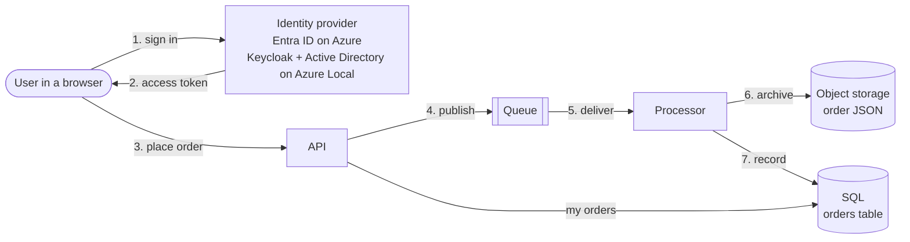

# Order Management sample

An application written for Azure that moves to **Azure Local** without code changes: the same
application definition and the same container images run on AKS with Azure PaaS services, and on
AKS enabled by Arc on Azure Local, where the app keeps running when the site loses its link to Azure.

Use it as the **template for moving your own app**. The pattern is five steps; this sample is a
worked example of each one.

## What the app does

Users sign in to a browser app and place orders. The **API** publishes each order to a **queue**;
the **processor** archives the order as JSON in **object storage** and records it in **SQL**.



| Dependency | On Azure | On Azure Local |
|---|---|---|
| Queue | Azure Service Bus | RabbitMQ container |
| Object storage | Azure Blob Storage | Azurite container |
| SQL | Azure SQL Database | SQL Server container |
| User sign-in | Microsoft Entra ID | Keycloak, federated to the site's Active Directory |
| How the app authenticates to services | Entra Workload ID (no secrets) | Keycloak token for the queue; Kerberos (Active Directory) for SQL; Recipe-issued credentials for storage |
| Images and Recipes | Azure Container Registry | ACR connected registry inside the cluster |

The Azure Local column runs nothing in Azure at runtime. That is what lets the app keep working when
the site is cut off from Azure.

## Move your app in five steps

### 1. Declare what the app needs, not which Azure service

Replace Azure resource types in your app's Bicep with portable [Radius](https://docs.radapp.io)
resource types, and connect your containers to them.

```bicep
// Before: tied to Azure
resource bus     'Microsoft.ServiceBus/namespaces@2022-10-01-preview' = { ... }
resource storage 'Microsoft.Storage/storageAccounts@2023-05-01' = { ... }
resource server  'Microsoft.Sql/servers@2023-08-01-preview' = { ... }

// After: portable (deploy/app.bicep)
resource queue    'Portability.Messaging/messageQueues@2025-08-01-preview' = { ... }
resource archive  'Radius.Storage/objectStorage@2025-08-01-preview'               = { ... }
resource database 'Radius.Data/sqlServerDatabases@2025-08-01-preview'             = { ... }

resource processor 'Radius.Compute/containers@2025-08-01-preview' = {
  name: 'processor'
  properties: {
    containers: { processor: { image: processorImage } }
    connections: {
      queue:   { source: queue.id }
      archive: { source: archive.id }
      sql:     { source: database.id }
    }
  }
}
```

Object storage and SQL use Radius's built-in types. Radius has no queue type that covers both
Service Bus and RabbitMQ, so the library defines one in
[recipes/message-queue/messageQueues.yaml](../../recipes/message-queue/messageQueues.yaml).

Result: [deploy/app.bicep](./deploy/app.bicep) is identical on both platforms. Its only parameters
are the image references, the sign-in settings and a SQL password.

### 2. Let the code read its connections

Each connection injects the connected resource's values as environment variables named
`CONNECTION_<connection>_<property>`, for example `CONNECTION_QUEUE_PROVIDER` and
`CONNECTION_QUEUE_ENDPOINT`. The code reads those instead of hard-coding a service, and picks its
client in one place,
[ServiceCollectionExtensions.cs](./src/OrderManagement.Shared/DependencyInjection/ServiceCollectionExtensions.cs):

```csharp
return options.Provider switch
{
    QueueProvider.ServiceBus => new ServiceBusMessageBroker(...),
    QueueProvider.RabbitMq   => new RabbitMqMessageBroker(...),
};
```

Everything else in the app sees only `IMessagePublisher` / `IMessageSubscriber`. Storage and SQL
follow the same rule: a connection string or password means the on-site container, none means
managed identity.

Sign-in stays an ordinary Entra app: MSAL.js in the browser and Microsoft.Identity.Web in the API.
On Azure Local, Keycloak issues tokens shaped like Entra's, so only settings change. See
[How authentication works](#how-authentication-works).

### 3. Write one Recipe per resource for each platform

A Recipe is a Bicep template Radius runs to create a resource. It returns the values that become
the `CONNECTION_*` variables, so both Recipes for a resource must return the same names. The
Recipes are shared by the library, in [recipes/](../../recipes/) at the repository root; this
sample uses them as they are.

| Resource | Azure Recipe | Azure Local Recipe |
|---|---|---|
| Queue | [servicebus-queue.bicep](../../recipes/message-queue/azure/service-bus/servicebus-queue.bicep) | [rabbitmq-queue.bicep](../../recipes/message-queue/azure-local/rabbitmq/rabbitmq-queue.bicep) |
| Object storage | [blob-objectstorage.bicep](../../recipes/object-storage/azure/blob-storage/blob-objectstorage.bicep) | [azurite-objectstorage.bicep](../../recipes/object-storage/azure-local/azurite/azurite-objectstorage.bicep) |
| SQL | [azuresql-database.bicep](../../recipes/sql-database/azure/azure-sql/azuresql-database.bicep) | [mssql-database.bicep](../../recipes/sql-database/azure-local/sql-server/mssql-database.bicep) |
| Containers | [kubernetes-containers.bicep](../../recipes/kubernetes/kubernetes-containers.bicep) (shared) | same |

### 4. Bind them per platform with a Recipe Pack and an Environment

A **Recipe Pack** says which Recipe serves each resource type, and carries every setting that
differs between platforms. An **Environment** is a deployment target that points at one pack.

| | [Azure pack](../../recipe-packs/azure.bicep) | [Azure Local pack](../../recipe-packs/azure-local.bicep) |
|---|---|---|
| Recipes from | your ACR | the connected registry in the cluster |
| Pod identity | service account + Entra Workload ID label | service account + Keycloak token and CA; Kerberos keytab for SQL |
| Image pulls | AcrPull on the cluster | image pull secret |
| Radius's stock secrets Recipe | from ghcr.io | mirrored into ACR and synced into the cluster |
| Environment | [azure.bicep](./deploy/environments/azure.bicep): also names the subscription and resource group for PaaS resources | [azurelocal.bicep](./deploy/environments/azurelocal.bicep): no Azure settings |

### 5. Deploy the same app to either environment

```powershell
rad deploy deploy/app.bicep -e oms-azure      -p apiImage=... -p processorImage=... -p sqlAdminPassword=...
rad deploy deploy/app.bicep -e oms-azurelocal -p apiImage=... -p processorImage=... -p sqlAdminPassword=...
```

Same file, same parameters. The environment decides what gets created. Also pass `apiAuthentication`
and `spaSettings`, the sign-in settings from step 2 for that platform's identity provider.

## Prerequisites

Set these up once per site, before deploying. They're the platform, not part of your app; the
app itself is only what's in [deploy/](./deploy).

### Azure

| Need | In this sample |
|---|---|
| AKS with the OIDC issuer and workload identity | [infra/azure/platform.bicep](./infra/azure/platform.bicep) |
| Azure Container Registry for images and Recipes, with AcrPull for the cluster | same template |
| A user-assigned managed identity with a federated credential for the app's service account | same template |
| Radius on the cluster, with an Azure credential so Recipes can create Azure resources | `rad install kubernetes --set global.azureWorkloadIdentity.enabled=true`, then `rad credential register azure wi` |
| Entra app registrations for the API and the browser app | [configure-app-identity.ps1](./scripts/azure/configure-app-identity.ps1) |
| Ingress with a public HTTPS name | [provision-ingress.ps1](./scripts/azure/provision-ingress.ps1) |

Deploy the template at subscription scope; it needs Owner or User Access Administrator, because it
assigns roles:

```powershell
az deployment sub create --location <region> --template-file infra/azure/platform.bicep `
    -p location=<region> registryName=<globally-unique-acr-name>
```

### Azure Local

| Need | Why | In this sample |
|---|---|---|
| AKS enabled by Arc, with Radius installed | runs the app and the Recipes | `az aksarc create`; Radius installed from the local registry |
| A registry the cluster can pull from without Azure | pods restarted during an outage must find their images, and Radius its Recipes | ACR (Premium) + **ACR connected registry** inside the cluster |
| An identity provider on site | sign-in and service tokens without Entra | **Keycloak**, federated to Active Directory over LDAPS and trusting the cluster's token issuer |
| Active Directory | users and groups | the domain the Azure Local instance already uses; Keycloak needs a read-only bind account |
| Ingress | users reach the app over HTTPS | Arc load balancer + NGINX ingress |

**When the site loses its link to Azure:** running pods, pod restarts, token exchange, directory
lookups and `kubectl` with the admin kubeconfig keep working. Pushing new images, Azure management of
the cluster and Entra sign-in to the cluster do not.

## How authentication works

There are two kinds of authentication: **users** signing in to the app, and the **app's own pods**
signing in to the queue, storage and SQL.

### Users: sign-in and roles

```
1. Browser loads /config.json from the API        → which identity provider, client ID and scope to use
2. MSAL.js redirects the user to the provider     → Entra ID, or Keycloak (password checked against AD)
3. Provider returns an access token to the browser  (authorization code + PKCE)
4. Browser calls /api/... with  Authorization: Bearer <token>
5. API validates the token: issuer, signature, audience, scope 'access_as_user'
6. API checks the 'roles' claim: Orders.Read to list orders, Orders.Create to place one
```

The code is written once, for Entra, and doesn't know which provider it is talking to:

| Piece | File | What it does |
|---|---|---|
| Browser sign-in | [app.js](./src/OrderManagement.Api/wwwroot/js/app.js) | MSAL.js `PublicClientApplication`, built from `/config.json` |
| Browser settings | [SpaSettings.cs](./src/OrderManagement.Api/SpaSettings.cs) | serves `/config.json` from the `Spa` settings; allows the provider's origin in the Content Security Policy |
| Token validation | [Program.cs](./src/OrderManagement.Api/Program.cs) | `AddMicrosoftIdentityWebApi` from the `AzureAd` settings; `RequireScope("access_as_user")` on `/api` |
| Roles | [OrderAuthorization.cs](./src/OrderManagement.Api/OrderAuthorization.cs) | policies on `Orders.Read` / `Orders.Create`; the user's ID is the `oid` claim |

Only the settings differ. They are the `apiAuthentication` and `spaSettings` parameters of
[app.bicep](./deploy/app.bicep), which become `AzureAd__*` and `Spa__*` environment variables on the
API:

| Setting | Entra ID (Azure) | Keycloak (Azure Local) |
|---|---|---|
| `apiAuthentication` | `Instance: https://login.microsoftonline.com/`<br>`TenantId: <tenant>`<br>`ClientId: <API app ID>` | `Authority: https://<keycloak>/realms/oms`<br>`MetadataAddress: <Authority>/.well-known/openid-configuration`<br>`ClientId: oms-api`<br>`Audience: oms-api` |
| `spaSettings` | `Authority: https://login.microsoftonline.com/<tenant>`<br>`ClientId: <SPA app ID>`<br>`ProtocolMode: AAD`<br>`ApiScope: api://<API app ID>/access_as_user` | `Authority: https://<keycloak>/realms/oms`<br>`ClientId: oms-spa`<br>`ProtocolMode: OIDC`<br>`KnownAuthorities: <keycloak host>`<br>`ApiScope: api://oms-api/access_as_user` |

`MetadataAddress` is needed because Microsoft.Identity.Web otherwise adds Entra's `/v2.0` to the
authority. `KnownAuthorities` stops MSAL from checking the authority against Entra.

Both providers need the same registrations. On Keycloak,
[configure-app-identity.ps1](./scripts/azurelocal/configure-app-identity.ps1) creates them and adds
the claim mappers that make the token match Entra's:

| Needed | Entra ID | Keycloak (realm `oms`) |
|---|---|---|
| The API | app registration exposing scope `access_as_user`, with app roles `Orders.Read`, `Orders.Create` | confidential client `oms-api` with no flows, used only as the token audience; realm roles `Orders.Read`, `Orders.Create` |
| The browser app | SPA app registration, redirect URI = the app's URL | public client `oms-spa`, standard flow with PKCE (S256), redirect URI = the app's URL |
| The scope | `api://<API app ID>/access_as_user` | client scope `api://oms-api/access_as_user`, optional on `oms-spa` |
| Token claims | built in: `aud`, `scp`, `roles`, `oid` | mappers on that scope: `aud` = `oms-api`, `scp` = `access_as_user`, `roles` = realm roles as a flat list, `oid` = the user's ID |
| Who gets which role | app roles assigned to Entra groups | AD groups mapped to realm roles (see [Connect your Active Directory](#connect-your-active-directory)) |

### Workloads: the app's access to the queue, storage and SQL

The API and processor pick their credential from what their connection provides, so the code has
no platform switch:

| Service | Azure | Azure Local | Where the choice is made |
|---|---|---|---|
| Queue | Entra Workload ID: the pod's Kubernetes token is exchanged for an Entra token for Service Bus | the pod's Kubernetes token is exchanged at Keycloak for a token RabbitMQ accepts | [ServiceCollectionExtensions.cs](./src/OrderManagement.Shared/DependencyInjection/ServiceCollectionExtensions.cs): OAuth when the connection has `oauth*` values |
| Object storage | Entra Workload ID | Azurite connection string, issued by the Recipe | [ArchiveOptions.cs](./src/OrderManagement.Shared/Configuration/ArchiveOptions.cs): managed identity when there is no connection string |
| SQL | Entra Workload ID; the app's managed identity is the database admin | Kerberos as the app's AD account, from a keytab the platform mounts; the `sa` login only when no keytab is configured | [SqlOptions.cs](./src/OrderManagement.Shared/Configuration/SqlOptions.cs): Entra with a workload identity, else Kerberos with a keytab, else the SQL login |

- **Azure:** [AzureCredentialFactory.cs](./src/OrderManagement.Shared/Identity/AzureCredentialFactory.cs)
  uses `WorkloadIdentityCredential`. The Recipe Pack gives the pods the `oms-workload-identity`
  service account and the Workload ID label, and the managed identity has a federated credential
  that trusts that service account.
- **Azure Local:** [WorkloadTokenProvider.cs](./src/OrderManagement.Shared/Identity/WorkloadTokenProvider.cs)
  sends the pod's projected Kubernetes token to Keycloak as a client assertion
  (`client_credentials`, `jwt-bearer`) and uses the access token it gets back as the RabbitMQ
  password. Keycloak trusts the cluster's token issuer, the same way Entra trusts it through the
  federated credential. The Recipe Pack projects the token at `/var/run/secrets/identity/token`
  and mounts Keycloak's CA certificate.
- **Azure Local, SQL:** the Recipe Pack mounts a Kerberos client keytab for the app's AD account
  and `krb5.conf`, and sets `KRB5_CLIENT_KTNAME`. Kerberos gets tickets from the keytab on its
  own, so the app connects with `Integrated Security=true` and holds no SQL password. SQL Server
  accepts the ticket with its own keytab and maps it to the app's Windows login, which the SQL
  Recipe creates. See [Connect your Active Directory](#connect-your-active-directory).

Every step runs inside the site, so this keeps working without Azure. The full walkthrough,
including decoded tokens and troubleshooting, is in
[docs/workload-identity.md](./docs/workload-identity.md).

## Connect your Active Directory

On Azure, app roles are assigned to Entra groups. On Azure Local the same roles come from **Active
Directory groups**, read by Keycloak. Your directory needs a few objects, and Keycloak needs to
know where to find them.

### 1. Create the objects in AD

Run this as a domain administrator on any machine with the Active Directory PowerShell module
(RSAT), for example the domain controller:

```powershell
$domain = Get-ADDomain
$ou     = "OU=OMS,$($domain.DistinguishedName)"

# An OU for the app's users and groups. Keycloak reads only this OU and below.
New-ADOrganizationalUnit -Name OMS -Path $domain.DistinguishedName

# One group per app role
New-ADGroup -Name oms-app-readers -GroupScope Global -GroupCategory Security -Path $ou   # Orders.Read
New-ADGroup -Name oms-app-writers -GroupScope Global -GroupCategory Security -Path $ou   # Orders.Create

# A read-only bind account for Keycloak. Every authenticated account can read the directory,
# so it needs no privileged group.
New-ADUser -Name svc-keycloak -SamAccountName svc-keycloak -Path $ou `
    -UserPrincipalName "svc-keycloak@$($domain.DNSRoot)" `
    -AccountPassword (Read-Host -AsSecureString 'Bind password') -PasswordNeverExpires $true -Enabled $true

# Give people access by adding them to the groups
Add-ADGroupMember -Identity oms-app-readers -Members <user>
Add-ADGroupMember -Identity oms-app-writers -Members <user>
```

Users who sign in to the app must sit in the OU (or below it). To use an existing OU instead, pass
its name to `keycloak.ps1 -AdOuName`.

Keycloak should reach the directory over **LDAPS (port 636)**, which needs the domain controller to
have a server certificate from a certificate authority, for example AD Certificate Services. Export
that CA's root certificate as `ca.crt` (Base-64 encoded).

### 2. Give Keycloak the bind account and the CA

```powershell
kubectl create namespace identity
kubectl -n identity create secret generic oms-ad-bind `
    --from-literal=bind-upn=svc-keycloak@<domain> --from-literal=bind-password=<password>
kubectl -n identity create secret generic oms-ad-ca --from-file=ca.crt=<path to ca.crt>
```

### 3. How Keycloak uses the directory

[keycloak.ps1](./scripts/azurelocal/keycloak.ps1) and
[configure-app-identity.ps1](./scripts/azurelocal/configure-app-identity.ps1) set this up:

| Keycloak setting | Value | Effect |
|---|---|---|
| User federation | LDAP, vendor Active Directory, `ldaps://<dc>:636`, users DN = the OU | users sign in with their AD user name (`sAMAccountName`) and password; Keycloak checks the password against AD |
| Edit mode | read only | AD stays the source of truth; Keycloak never writes to it |
| Import | on sign-in | a user appears in Keycloak the first time they sign in; there is no scheduled sync |
| Account controls mapper | on | disabled or locked AD accounts cannot sign in |
| Group mapper | groups DN = the OU, membership from the `member` attribute | AD groups appear as Keycloak groups; membership is read from AD, so changes apply at the user's next sign-in |
| Group → role mapping | `oms-app-readers` → `Orders.Read`, `oms-app-writers` → `Orders.Create` | the roles land in the token's `roles` claim, the same claim Entra uses, so the API's checks are unchanged |

Day to day, granting or removing access is only AD group membership. Nothing changes in Keycloak.

To add a role, create the AD group in the OU, add the role to the API, and map the group to the
role in Keycloak (*Groups* → the group → *Role mapping*). A new group shows up in Keycloak once a
member signs in, or straight away with *User federation* → *active-directory* → *Mappers* →
*group-mapper* → *Sync LDAP groups to Keycloak*. On Azure, the matching step is assigning the app
role to an Entra group.

### 4. Let the app sign in to SQL Server with Kerberos

SQL Server on Linux, including the container, accepts Active Directory logins through Kerberos
([Microsoft's guide](https://learn.microsoft.com/sql/linux/containers/tutorial-adutil)). The app then
signs in as its own AD account instead of with a SQL password. Kerberos needs only the domain
controller, which is on site, so this keeps working without Azure.

| In AD | Purpose |
|---|---|
| `svc-oms-sql` with SPNs `MSSQLSvc/ordersdb.oms-azurelocal.svc.cluster.local:1433` and `MSSQLSvc/ordersdb.oms-azurelocal.svc.cluster.local` | SQL Server's service account; clients request tickets for these names. The host is the SQL Recipe's Service, `<resource name>.<namespace>.svc.cluster.local` |
| `svc-oms-app` | the app's account; becomes the SQL login `AZURELOCAL\svc-oms-app` |
| AES encryption only on both (`Set-ADUser -KerberosEncryptionType AES128,AES256`) | the keytabs carry AES keys |
| A PTR record for every domain controller (reverse DNS) | SQL Server on Linux resolves each controller's address back to its name before it looks an account up; without it, logins fail with "untrusted domain" |

| In the app namespace | Keys | Used by |
|---|---|---|
| ConfigMap `oms-krb5` | `krb5.conf`: the realm and its domain controller, with `.svc.cluster.local` mapped to the realm; `kdc-address` and `kdc-hostnames`: the controller's IP and its names (FQDN, DNS domain, short domain name), which the SQL Recipe pins in the pod's hosts file because SQL Server on Linux resolves the short domain name as a host | SQL Server and the app |
| Secret `oms-sql-kerberos` | `mssql.keytab` (keys for `svc-oms-sql` and both SPNs), `account` | SQL Server |
| Secret `oms-app-kerberos` | `client.keytab` (keys for `svc-oms-app`), `login` | the app's pods |

When these exist, the Azure Local Recipe Pack passes them to the Recipes:
- **SQL Recipe:** configures SQL Server's keytab, then creates the Windows login and adds it to
  `dbcreator`, so the app can create its database.
- **Container Recipe:** gets the client keytab, `krb5.conf` and the Kerberos environment variables as
  plain volumes, mounts and environment variables from the pack, and adds them to every pod. The
  Recipe itself knows nothing about Kerberos.

Without them, SQL falls back to the `sa` login.

[ad-setup.ps1](./scripts/azurelocal/ad-setup.ps1) does steps 1 and 2 in one go, plus a test user,
when the domain controller is a Hyper-V VM on the machine you run it from (it uses PowerShell
Direct). It also does step 4. To redo only step 4 without touching Keycloak, run it with
`-KerberosOnly`, then redeploy.

## Deploy it by hand

With the prerequisites in place, deploying is only Radius commands. For Azure Local:

```powershell
# One-time: workspace, resource group, the queue resource type
rad workspace create kubernetes oms-azurelocal --context <kube-context> --group oms
rad resource-type create messageQueues -f ../../recipes/message-queue/messageQueues.yaml
rad bicep publish-extension -f ../../recipes/message-queue/messageQueues.yaml --target ../../recipes/message-queue/messageQueues.tgz
rad env create bootstrap --group oms      # scratch environment to deploy the pack and environment from

# Publish the Recipes, then bind them for this platform
./scripts/publish-recipes.ps1 -Registry <acr>.azurecr.io -Platform azure-local
rad deploy ../../recipe-packs/azure-local.bicep -e bootstrap -p registry=<in-cluster registry> ...
rad deploy deploy/environments/azurelocal.bicep -e bootstrap

# The app
rad deploy deploy/app.bicep -e oms-azurelocal -p apiImage=... -p processorImage=... -p sqlAdminPassword=...
```

For Azure, use `recipe-packs/azure.bicep` and `deploy/environments/azure.bicep` instead. When Recipes come
from a private registry (always on Azure Local), Radius also needs pull credentials: see
[deploy/recipe-registry-credentials.bicep](./deploy/recipe-registry-credentials.bicep).

## Optional: the automation we used

The [scripts/](./scripts) folder is how we built and deployed our own Azure and Azure Local test
sites from nothing. You do not need it to follow the pattern above; use it if you want the same
end-to-end setup.

| Command | When | What it runs |
|---|---|---|
| `./scripts/setup-platform.ps1 -Target Azure` or `AzureLocal` | once per site | the prerequisite steps in `scripts/azure/` or `scripts/azurelocal/` |
| `./scripts/deploy.ps1 -Target Azure` or `AzureLocal` | every release | build and push images, publish Recipes, the `rad` steps above |

Both read site values from `scripts/settings.json`; copy it from
[settings.example.json](./scripts/settings.example.json). Each script documents itself:
`Get-Help ./scripts/<path>.ps1 -Full`.

## Repository layout

The sample uses the library's shared [recipes/](../../recipes/) and
[recipe-packs/](../../recipe-packs/) at the repository root. The sample folder holds:

```
├── src/                         application code (.NET)
│   ├── OrderManagement.Api/        orders API and browser app
│   ├── OrderManagement.Processor/  order processor
│   └── OrderManagement.Shared/     connections, identity, queue/storage/SQL clients
├── deploy/                      what `rad deploy` uses, every release (Bicep)
│   ├── app.bicep                   the application, same on both platforms
│   ├── environments/               one per platform; each points at a Recipe Pack
│   └── recipe-registry-credentials.bicep  Radius credentials for a private Recipe registry
├── infra/                       one-time platform prerequisites, not part of the app
│   └── azure/                      platform.bicep: AKS, ACR, managed identity
├── docker/                      Dockerfiles for the API and processor
├── docs/                        workload identity explained
└── scripts/                     optional automation (see above)
```

## Configuration reference

Radius injects these into the API and the processor from their connections. The same names work in
`appsettings.json` as `OrderManagement:<connection>:<property>`.

| Variable | Used by | Notes |
|---|---|---|
| `CONNECTION_QUEUE_PROVIDER` | both | `servicebus` or `rabbitmq` |
| `CONNECTION_QUEUE_QUEUENAME` | both | queue name |
| `CONNECTION_QUEUE_ENDPOINT` | both | Service Bus namespace host name, or `host:port` for RabbitMQ |
| `CONNECTION_QUEUE_OAUTH*` | both | Azure Local: Keycloak token endpoint, client and token file |
| `CONNECTION_QUEUE_USERNAME` / `_PASSWORD` | both | only when the queue Recipe issues credentials |
| `CONNECTION_ARCHIVE_ENDPOINT` / `_CONTAINERNAME` | processor | blob endpoint and container |
| `CONNECTION_ARCHIVE_CONNECTIONSTRING` | processor | Azure Local (Azurite) only |
| `CONNECTION_SQL_HOST` / `_PORT` / `_DATABASE` | both | |
| `CONNECTION_SQL_USERNAME` / `_PASSWORD` | both | ignored when the pod has an Entra workload identity or a Kerberos keytab |

## Known gaps

- The sample ships its own build of the stock Kubernetes container Recipe
  ([kubernetes-containers.bicep](../../recipes/kubernetes/kubernetes-containers.bicep)) so the platform can set service
  accounts, pull secrets, ingress, and extra volumes, mounts and environment variables. Each
  platform scenario (identity provider token and CA, Kerberos keytab) is defined in the Recipe Pack
  with those generic inputs, so the Recipe never changes for a new scenario. Upstream support is tracked in
  radius-project/resource-types-contrib#143.
- The Azure SQL Recipe allows access from all Azure services. Use a private endpoint for production.
- Radius 0.60 cannot delete the role assignments the Azure Recipes create, so deleting the app on
  Azure leaves Radius retrying. Delete the Azure resource group directly.
- `InvariantGlobalization` must stay `false`: `Microsoft.Data.SqlClient` requires ICU.
