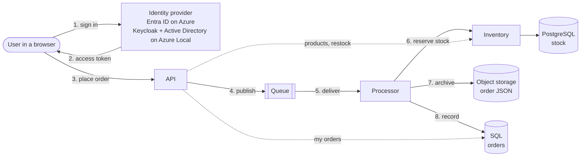

# Order Management App

An app written for Azure that moves to **Azure Local** without code changes. The same app
definition and the same container images run on AKS with Azure PaaS services, and on AKS enabled by
Arc on Azure Local, where the app keeps running when the site loses its link to Azure.

Use it as a template for moving your own app: [Move your app in five steps](./docs/move-your-app.md).

## Architecture

Users sign in to a browser app and place orders. The **API** prices each order from the
**inventory** service and publishes it to a **queue**. The **processor** reserves the stock with the
inventory service, archives the order as JSON in **object storage** and records it in **SQL**, as
completed, or rejected when stock ran out. Inventory admins restock products from the same app.



Each service runs as its own identity and gets only what it needs: the API may send to the queue and
read orders, the processor may receive, write orders and reserve stock, and only the inventory
service touches the stock database. The services call each other with their own tokens; a user's
token never reaches the inventory service. Network policies only let in the traffic each service
needs.

| Dependency | On Azure | On Azure Local |
|---|---|---|
| Queue | Azure Service Bus | RabbitMQ container |
| Object storage | Azure Blob Storage | Azurite container |
| SQL (orders) | Azure SQL Database | SQL Server container |
| PostgreSQL (stock) | Azure Database for PostgreSQL flexible server | PostgreSQL container |
| User sign-in | Microsoft Entra ID | Keycloak, federated to the site's Active Directory |
| How each service authenticates | Its own managed identity, through Entra Workload ID (no secrets) | Its own Kubernetes service account token, exchanged with Keycloak for the queue and the inventory service; its own database user, password from Key Vault |
| Secrets | None: databases use Entra authentication | Database passwords in Azure Key Vault, synced into the cluster by the Secret Store extension |
| Monitoring | Application Insights, with alerts | On-site OpenTelemetry collector, Prometheus and Grafana, with alerts |
| Images and Recipes | Azure Container Registry | ACR connected registry inside the cluster |
| HTTPS address | Managed NGINX ingress (app routing add-on) on a public IP, `<label>.<region>.cloudapp.azure.com`, certificate from Let's Encrypt | NGINX ingress on an address from the Arc load balancer on the site network, certificate from a site CA, renewed by cert-manager in the cluster |

The Azure Local column runs nothing in Azure at runtime. That is what lets the app keep working when
the site is cut off from Azure. Key Vault is only read while the link is up; the cluster keeps the
last synced passwords.

## Prerequisites

All commands run from this folder, `samples/OrderManagementApp`.

**To run the app locally:**

- [.NET 9 SDK](https://dotnet.microsoft.com/download/dotnet/9.0)
- [Docker](https://docs.docker.com/get-docker/) or [Podman](https://podman.io/docs/installation)

**To deploy to Azure:**

- Owner on an Azure subscription (the template assigns roles), and the right to register apps in
  Microsoft Entra ID.
- [Azure Developer CLI](https://aka.ms/azd-install)
- [Azure CLI](https://learn.microsoft.com/cli/azure/install-azure-cli), with `kubectl` and
  `kubelogin` (`az aks install-cli`)
- [Helm](https://helm.sh/docs/intro/install/)
- [Radius CLI 0.60](https://docs.radapp.io/installation/)
- [PowerShell 7](https://learn.microsoft.com/powershell/scripting/install/installing-powershell)
- Docker or Podman

**To deploy to Azure Local:**

- An Azure Local instance, [deployed](https://learn.microsoft.com/azure/azure-local/deploy/deployment-introduction)
  and connected to Azure, with its custom location and a running Arc resource bridge. See the
  [system requirements](https://learn.microsoft.com/azure/azure-local/concepts/system-requirements-23h2).
- Free capacity on the instance for the AKS cluster: three VMs of 4 vCPUs and 8 GB each (one control
  plane, two nodes), plus about 50 GB of storage for the in-cluster registry and Keycloak's database.
- A management machine on the site network, not an Azure Local node, that can also sign in to
  Azure, with the same tools as for Azure except azd. Microsoft recommends managing AKS on Azure
  Local from such a
  [client machine](https://learn.microsoft.com/azure/aks-hybrid-edge/local/aks-create-clusters-cli#install-the-azure-cli-extension)
  rather than from the nodes.
- Free addresses on the site network for the AKS cluster: its control plane, a pool for the nodes and a
  small range for the load balancer.
- The site's Active Directory, with the app's groups and a bind account for Keycloak. See
  [Connect your Active Directory](./docs/authentication.md#connect-your-active-directory).
- Contributor and User Access Administrator on the subscription, and the right to create groups in
  Entra ID.

## Run the app locally

The app runs with RabbitMQ, SQL Server, PostgreSQL, Azurite and Keycloak in containers: the same
services as on Azure Local, with no cluster and no Radius.

```powershell
dotnet dev-certs https --trust
dotnet dev-certs https --export-path local/certs/localhost.crt --format Pem --no-password
docker compose up --build
```

On Linux and macOS, also run `chmod 644 local/certs/localhost.*` before `docker compose up`, so the
Keycloak container can read the certificate.

Open http://localhost:8080 and sign in as `demo`, password `demo`, to place orders, or as `manager`,
password `manager`, to restock.

The build downloads packages from nuget.org and images from mcr.microsoft.com, docker.io and quay.io.
If your network blocks them, ask for access, or point the build at your own NuGet feed with a
[NuGet.Config](https://learn.microsoft.com/nuget/reference/nuget-config-file) in this folder; the
build uses it when it's there, and Git ignores it.

## Deploy to Azure

```powershell
azd auth login
az login
azd up
```

azd and the Azure CLI keep separate sign-ins, and `azd up` uses both, so sign in to the same tenant
with each.

If your Entra tenant requires a service management reference on app registrations (the Microsoft
corporate tenant does), set it before `azd up`:

```powershell
azd env set SERVICE_MANAGEMENT_REFERENCE <service tree ID>
```

`azd up` creates AKS, a container registry, a managed identity for each service and Application
Insights, installs Radius and an HTTPS ingress, registers the app in Entra ID, then builds and
deploys the app. It prints the app's address. Your account gets all the app roles, including
`Inventory.Manage`, so you can place orders and restock straight away.

To get alerts by email (orders stuck in the queue, the processor stalled, stock below its reorder
level), set an address before `azd up`:

```powershell
azd env set ALERT_EMAIL <address>
```

Settings for your subscription, if you need them, are listed at the top of
[azure.yaml](./azure.yaml) (`azd env set ...`).

If `azd up` fails because a VM size or service isn't available in your region
([SkuNotAvailable](https://learn.microsoft.com/azure/azure-resource-manager/troubleshooting/error-sku-not-available)
or a capacity error), pick another size or region, then run `azd up` again:

```powershell
azd env set AKS_NODE_VM_SIZE <size>     # the cluster's nodes, Standard_D4s_v7 by default
azd env set SQL_LOCATION <region>       # Azure SQL only
azd env set POSTGRES_LOCATION <region>  # PostgreSQL only
```

To move everything to another region, start a new environment there: `azd env new <name> --location <region>`.
List the VM sizes a region offers with `az vm list-skus --location <region> --resource-type virtualMachines -o table`.

## Deploy to Azure Local

On the management machine, copy [scripts/settings.example.json](./scripts/settings.example.json) to
`scripts/settings.json` and fill in the `AzureLocal` section. [Azure Local settings](./docs/azure-local-settings.md)
says where to find each value. Then run:

```powershell
./scripts/up.ps1 -Target AzureLocal
```

It checks the site, creates the AKS cluster and everything the app needs on it, and deploys the app.
Open the address it prints and sign in with an AD account in one of the app's groups. The first
time, trust the site CA with the command it printed.

To deploy a new version later, run `./scripts/deploy.ps1 -Target AzureLocal`.

RabbitMQ, SQL Server and PostgreSQL each keep their data on a persistent volume on the cluster's
default storage class, so a restarted pod keeps its queued messages, orders and stock. Azurite, a
stand-in to be replaced, keeps none: the archived order files are lost when its pod restarts. An
order that fails `maxDeliveryCount` times (10) moves to the `orders.dead-letter` queue, as it moves
to the dead-letter queue in Service Bus on Azure. cert-manager renews the app's, Keycloak's and
PostgreSQL's certificates on site, from the site CA, 30 days before they expire. For production, you
would also need:

- **High availability:** this is a sample app with one replica of each service running. For
  production, consider running multiple replicas of each service for HA.
- **Backups:** nothing backs up the volumes. Schedule SQL Server and PostgreSQL backups and copy them
  off the cluster.
- **A supported object store:** Azurite is an emulator that keeps no data. Use an S3- or
  Blob-compatible store supported for production.
- **Sizing:** the volume sizes and CPU and memory limits are small defaults; set them from your load.
- **Licensing:** SQL Server runs the Developer edition, which isn't licensed for production. Set
  `SqlServerEdition` in the `Deploy` settings to `Standard`, `Enterprise` or your product key.
- **Upgrades:** the image tags float (`2022-latest`, `4-management-alpine`, `17-alpine`). Pin them,
  and test upgrades before rolling them out.
- **Hardening:** traffic to RabbitMQ and Azurite is not encrypted, and the app does not verify SQL
  Server's certificate. Add TLS with trusted certificates.

The database passwords live in Key Vault. To change one, set a new version of its secret in the
vault (`sql-admin-password`, `postgres-admin-password`, `sql-api-password`,
`sql-processor-password` or `postgres-inventory-password`). Once the Secret Store extension has
synced it (hourly by default), run `./scripts/deploy.ps1 -Target AzureLocal -SkipImageBuild -SkipRadiusInstall`
to set it in the database and restart the service.

## Clean up

**Locally:** `docker compose down`.

**Azure:** `azd down`. It deletes the resource group, including what the Recipes created in it, and
the app registrations.

**Azure Local:** delete the resource group the scripts created (`ResourceGroup` in the settings,
`bcd-azurelocal` by default), which holds the AKS cluster, the registry and the logical network:

```powershell
az group delete --name bcd-azurelocal
```

The AKS cluster's Entra admin group and the objects `ad-setup.ps1` added to Active Directory stay;
remove them by hand if you no longer need them.

## Understand how it works

| | |
|---|---|
| [Move your app in five steps](./docs/move-your-app.md) | resource types, connections, Recipes, Recipe Packs, environments |
| [How authentication works](./docs/authentication.md) | user sign-in, each service's identity and permissions, connecting Active Directory |
| [Monitoring on Azure Local](./infra/azurelocal/observability/README.md) | the on-site metrics, logs, traces, dashboard and alerts |
