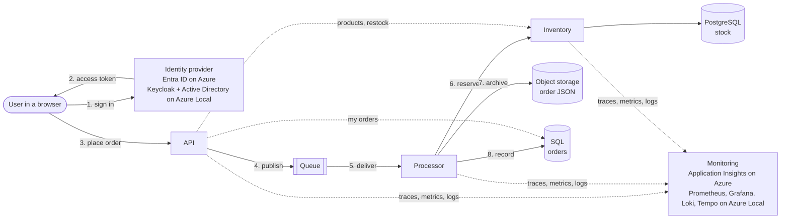

# Order Management App

An app written for Azure that moves to **Azure Local** without code changes. The same app
definition and the same container images run on AKS with Azure PaaS services, and on AKS enabled by
Arc on Azure Local, where the app keeps running when the site loses its link to Azure.

Use it as a template for moving your own app: [Move your app in five steps](./docs/move-your-app.md).

## Architecture

Users sign in to a browser app and place orders. The **API** prices them from the **inventory**
service and publishes each order to a **queue**; the **processor** reserves stock, archives the
order as JSON in **object storage** and records it in **SQL**. Every service sends its traces,
metrics and logs to **monitoring**.



| Dependency | On Azure | On Azure Local |
|---|---|---|
| Queue | Azure Service Bus | RabbitMQ |
| Object storage | Azure Blob Storage | SeaweedFS (S3) |
| SQL (orders) | Azure SQL Database | SQL Server container |
| PostgreSQL (stock) | Azure Database for PostgreSQL | PostgreSQL (CloudNativePG) |
| User sign-in | Microsoft Entra ID | Keycloak, federated to the site's Active Directory |
| How the app authenticates to services | Entra Workload ID (no secrets) | Kubernetes service account tokens exchanged with Keycloak, for the queue and the inventory service; per-service database logins and object store keys generated on site |
| Monitoring | Application Insights | Prometheus, Grafana, Loki and Tempo in the cluster |
| Images and Recipes | Azure Container Registry | ACR connected registry inside the cluster |
| HTTPS address | Managed NGINX ingress (app routing add-on) on a public IP, `<label>.<region>.cloudapp.azure.com`, certificate from Let's Encrypt or a CA kept in the cluster | NGINX ingress on an address from the Arc load balancer on the site network, certificate from a site CA, renewed by cert-manager in the cluster |

Each service runs as its own identity with least privilege, and calls between services and to the
backing services use TLS. The Azure Local column runs nothing in Azure at runtime. That is what lets
the app keep working when the site is cut off from Azure.

## Prerequisites

All commands run from this folder, `samples/OrderManagementApp`.

**To run the app locally:**

- [.NET 10 SDK](https://dotnet.microsoft.com/download/dotnet/10.0)
- [Docker](https://docs.docker.com/get-docker/) or [Podman](https://podman.io/docs/installation)

**To deploy to Azure:**

- Owner on an Azure subscription (the template assigns roles), and the right to register apps in
  Microsoft Entra ID.
- [Azure Developer CLI](https://aka.ms/azd-install)
- [Azure CLI](https://learn.microsoft.com/cli/azure/install-azure-cli), with `kubectl` and
  `kubelogin` (`az aks install-cli`)
- [Helm](https://helm.sh/docs/intro/install/)
- [Radius CLI 0.60](https://docs.radapp.io/installation/)
- [PowerShell 7.3 or later](https://learn.microsoft.com/powershell/scripting/install/installing-powershell)
- Docker or Podman

**To deploy to Azure Local:**

- An Azure Local instance, [deployed](https://learn.microsoft.com/azure/azure-local/deploy/deployment-introduction)
  and connected to Azure, with its custom location and a running Arc resource bridge. See the
  [system requirements](https://learn.microsoft.com/azure/azure-local/concepts/system-requirements-23h2).
- Free capacity on the instance for the AKS cluster: a control plane of 4 vCPUs and 6 GB and three
  workers of 4 vCPUs and 16 GB each (8 GB with `Availability` `standard`), plus about 120 GB of
  storage (80 GB with `standard`).
- A management machine on the site network, not an Azure Local node, with the same tools as for
  Azure except azd. Microsoft recommends managing AKS on Azure Local from such a
  [client machine](https://learn.microsoft.com/azure/aks-hybrid-edge/local/aks-create-clusters-cli#install-the-azure-cli-extension)
  rather than from the nodes.
- Free addresses on the site network for the AKS cluster: its control plane, a pool for the nodes and a
  small range for the load balancer.
- The site's Active Directory, with the app's groups and a bind account for Keycloak. See
  [Connect your Active Directory](./docs/authentication.md#connect-your-active-directory).
- Contributor and User Access Administrator on the subscription, and the right to create groups in
  Entra ID (or an existing group for the cluster's administrators).

## Run the app locally

The app runs with RabbitMQ, SQL Server, PostgreSQL, SeaweedFS and Keycloak in containers: the same
services as on Azure Local, with no cluster and no Radius.

```powershell
dotnet dev-certs https --trust
dotnet dev-certs https --export-path local/certs/localhost.crt --format Pem --no-password
$env:LOCAL_PASSWORD = '<at least 8 characters, upper and lower case and digits>'
docker compose up --build
```

`LOCAL_PASSWORD` is the password of every local service: SQL Server, PostgreSQL, RabbitMQ, the
object store and Keycloak's admin. On Linux and macOS, also run `chmod 644 local/certs/localhost.*`
before `docker compose up`, so the Keycloak container can read the certificate.

Open http://localhost:8080 and sign in as `demo`, password `demo`, to place orders, or as `manager`,
password `manager`, to restock. Run the tests with `dotnet test`.

The build downloads packages from nuget.org and images from mcr.microsoft.com, docker.io and quay.io.
If your network blocks them, ask for access, or point the build at your own NuGet feed with a
[NuGet.Config](https://learn.microsoft.com/nuget/reference/nuget-config-file) in this folder; the
build uses it when it's there, and Git ignores it.

## Deploy to Azure

```powershell
azd auth login
az login
azd up
```

azd and the Azure CLI keep separate sign-ins, and `azd up` uses both, so sign in to the same tenant
with each.

If your Entra tenant requires a service management reference on app registrations (the Microsoft
corporate tenant does), set it before `azd up`:

```powershell
azd env set SERVICE_MANAGEMENT_REFERENCE <service tree ID>
```

`azd up` creates AKS, a container registry and managed identities, installs Radius and an HTTPS
ingress, registers the app in Entra ID, then builds and deploys the app; the Recipes create Service
Bus, Blob Storage, Azure SQL and PostgreSQL. It prints the app's address. Your account gets the app
roles to place orders and restock, so you can sign in straight away.

Settings for your subscription, if you need them, are listed at the top of
[azure.yaml](./azure.yaml) (`azd env set ...`): the alert email, the DNS label, a CA kept in the
cluster where Let's Encrypt can't reach it, private endpoints for the databases and storage, and
peering with a hub virtual network.

If `azd up` fails because a VM size or service isn't available in your region
([SkuNotAvailable](https://learn.microsoft.com/azure/azure-resource-manager/troubleshooting/error-sku-not-available)
or a capacity error), pick another size or region, then run `azd up` again:

```powershell
azd env set AKS_NODE_VM_SIZE <size>   # the cluster's nodes, Standard_D4s_v7 by default
azd env set SQL_LOCATION <region>     # Azure SQL only
azd env set POSTGRES_LOCATION <region> # PostgreSQL only
```

To move everything to another region, start a new environment there: `azd env new <name> --location <region>`.
List the VM sizes a region offers with `az vm list-skus --location <region> --resource-type virtualMachines -o table`.

## Deploy to Azure Local

> **Scope.** This sample deploys the same app to Azure and to Azure Local; each deployment starts
> with its own data. Moving a running workload between them (copying orders, stock and archived
> orders, switching users between addresses, keeping order history across Entra ID and Keycloak)
> isn't covered yet and will follow in a later iteration.

On the management machine, copy [scripts/settings.example.json](./scripts/settings.example.json) to
`scripts/settings.json` and fill in the `AzureLocal` section. [Azure Local settings](./docs/azure-local-settings.md)
says where to find each value. Then run:

```powershell
./scripts/up.ps1 -Target AzureLocal
```

It checks the site, creates the AKS cluster and everything the app needs on it, and deploys the app.
Open the address it prints and sign in with an AD account in one of the app's groups. The first
time, on a machine outside the domain, trust the site CA with the command it printed.

To deploy a new version later, run `./scripts/deploy.ps1 -Target AzureLocal`.

`Common.Availability` sets how the backing services run; choose it before the first deployment. With
`high` (the default), RabbitMQ runs three nodes, PostgreSQL a primary and two replicas with continuous
backups to the object store, and the object store keeps its data on several workers, so losing a
worker loses nothing. `standard` runs one of each and needs less capacity.

Every backing service keeps its data on persistent volumes on the cluster's default storage class.
An order that fails `maxDeliveryCount` times (10) moves to the `orders.dead-letter` queue, as it moves
to the dead-letter queue in Service Bus on Azure. cert-manager renews the certificates on site, from
the site CA, 30 days before they expire. Database passwords and object store keys are generated on
site and kept only in the cluster; [Running on Azure Local](./docs/run-on-azure-local.md) covers
rotating them and running without the link to Azure.

For production, you would also need:

- **SQL Server:** one instance, Express edition (free, up to 10 GB per database), no backups.
  Schedule backups, set `SqlServerEdition` for more, or consider
  [SQL Managed Instance enabled by Azure Arc](https://learn.microsoft.com/azure/azure-arc/data/managed-instance-overview).
- **Off-site backups:** PostgreSQL backups and archived orders stay in the cluster; copy them off
  site ([object storage](./infra/azurelocal/object-store/README.md)).
- **Secrets:** back up the cluster's Secrets, or accept resetting them after a rebuild.
- **Rotation:** `rotate-credentials.ps1`, run when needed. For automatic rotation use an on-site
  secret store such as [OpenBao](https://openbao.org) or [HashiCorp Vault](https://developer.hashicorp.com/vault).
- **Object store key:** the processor uses a stored S3 key. SeaweedFS can instead exchange its
  Keycloak token for temporary credentials (STS `AssumeRoleWithWebIdentity`), as RabbitMQ and the
  inventory service already use tokens; not done here.
- **Sizing and upgrades:** volume sizes and CPU and memory limits are small defaults; set them from
  your load. Images are pinned in [images.txt](./infra/azurelocal/images.txt); test new versions
  before rolling them out.
- **Access:** platform administrators hold broad rights; keep them to trusted operators.

## Clean up

**Locally:** `docker compose down`.

**Azure:** `azd down`. It deletes the resource group, including what the Recipes created in it, and
the app registrations.

**Azure Local:** delete the resource group the scripts created (`ResourceGroup` in the settings,
`bcd-azurelocal` by default), which holds the AKS cluster, the registry and the logical network:

```powershell
az group delete --name bcd-azurelocal
```

The AKS cluster's Entra admin group and the objects `ad-setup.ps1` added to Active Directory stay;
remove them by hand if you no longer need them.

## Understand how it works

| | |
|---|---|
| [Move your app in five steps](./docs/move-your-app.md) | resource types, connections, Recipes, Recipe Packs, environments |
| [How authentication works](./docs/authentication.md) | user sign-in, the app's access to its services, connecting Active Directory |
| [Running on Azure Local](./docs/run-on-azure-local.md) | running without the link to Azure, availability, rotating credentials |
| [Operators on Azure Local](./infra/azurelocal/operators/README.md) | replication, failover and backups |
| [Monitoring on Azure Local](./infra/azurelocal/observability/README.md) | metrics, logs, traces and alerts |