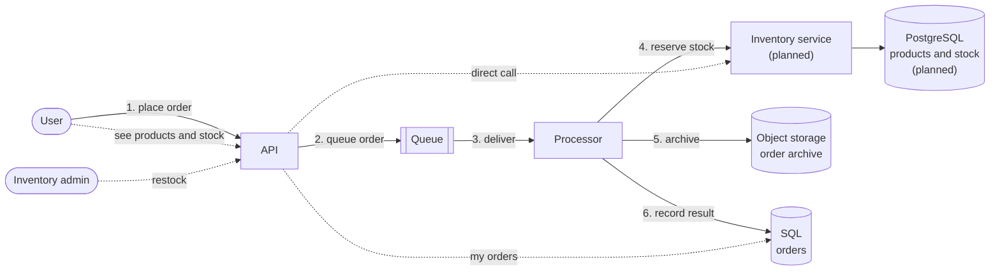

# Order Management App: design

The app shows how an app written for Azure runs unchanged on Azure Local, and keeps working when the
site loses its link to Azure. This page describes the resources on each platform, the production
patterns each one follows, and what's still missing. It also covers the next scope: inventory on
PostgreSQL, Key Vault for the site's database credentials, and observability.

Status: **Built** is in `main` and tested on both platforms. **Planned** is the next scope.

## Architecture

Users sign in through Entra ID on Azure, or Keycloak backed by Active Directory on Azure Local.

- **Placing an order (solid, numbered):** the API only queues the order, so ordering keeps working
  while the processor or the inventory service is busy or down. An order without enough stock is
  recorded as "Rejected: out of stock" (planned).
- **Products, stock and orders (dotted):** direct calls, not queued: the page waits for the
  answer, and the inventory admin sees the new stock straight away. Only users in the inventory
  admin group can restock (planned).
## Resources

| Resource | Azure | Azure Local | Status |
|---|---|---|---|
| Cluster | AKS, 2 nodes | AKS enabled by Arc: 1 control plane and 2 worker nodes | Built |
| Images and Recipes | Azure Container Registry | ACR connected registry inside the cluster, synced from ACR | Built |
| HTTPS address | Managed NGINX ingress, Let's Encrypt certificate | NGINX ingress on the Arc load balancer, site CA certificate renewed by cert-manager | Built |
| User sign-in | Entra ID | Keycloak (PostgreSQL behind it), federated to Active Directory | Built |
| Queue | Service Bus Standard | RabbitMQ container | Built |
| SQL | Azure SQL Database S0 | SQL Server 2022 container | Built |
| Object storage | Blob Storage, LRS | Azurite container (emulator) | Built |
| API, processor | Containers on the cluster | Same images, same app definition | Built |
| Inventory service | Container on the cluster | Same image, same app definition | Planned |
| PostgreSQL | Azure Database for PostgreSQL Flexible Server | PostgreSQL container | Planned |
| Secrets | None needed: workload identity everywhere | Key Vault, synced into the cluster by the Secret Store extension | Planned |
| Observability | Application Insights | OpenTelemetry Collector, Prometheus with Alertmanager, Loki, Tempo, Grafana | Planned |

## Production patterns by resource

✅ in place · ❌ missing · ➖ not applicable

### App (API, processor)

| Pattern | Status |
|---|---|
| Interfaces separate from implementations, dependency injection | ✅ |
| Repositories for SQL and storage; adapters for each broker and identity provider | ✅ |
| Processing a message twice is safe (SQL `MERGE`, archive overwritten) | ✅ |
| Health probes, CPU and memory limits | ✅ |
| Runs as a non-root user | ✅ |
| Images deployed by digest | ✅ |
| Multiple replicas, disruption budget | ❌ one replica each |
| Retries placing an order while the queue is down | ❌ returns an error instead |

### Identity

| Pattern | Azure | Azure Local |
|---|---|---|
| Users sign in through the organisation's directory | ✅ Entra ID | ✅ Keycloak backed by Active Directory |
| Services sign in with their own identity, no stored secret | ✅ for all services | ✅ queue only |
| Services get only the access they need | ✅ queue and storage ❌ SQL: the app's identity is the server's administrator | ❌ SQL: the app signs in as `sa` |
| Keycloak's AD account limited to reading the app's OU | ➖ | ✅ |
| Directory connection encrypted | ➖ | ✅ LDAPS |
| Sign-in service runs more than one replica | ➖ managed by Microsoft | ❌ one Keycloak, one database |
| Secrets stored outside the cluster | ➖ no secrets | ❌ only in the cluster (planned: Key Vault) |

### Queue

| Pattern | Azure (Service Bus) | Azure Local (RabbitMQ) |
|---|---|---|
| Failed messages dead-lettered after 10 deliveries | ✅ | ✅ |
| Messages survive a restart | ✅ | ✅ persistent volume |
| Only identity-based sign-in | ✅ local auth disabled | ❌ the app uses its identity, but a password user stays for the management UI |
| Encrypted connection | ✅ TLS 1.2 | ❌ |
| Survives a node or zone failure | ❌ needs Premium | ❌ single node |

### SQL

| Pattern | Azure (Azure SQL) | Azure Local (SQL Server) |
|---|---|---|
| Data survives a restart | ✅ | ✅ persistent volume |
| Backups | ✅ automatic | ❌ |
| Password-free sign-in | ✅ Entra only | ❌ password |
| App gets only the access it needs | ❌ server administrator | ❌ `sa` |
| Encrypted connection, certificate checked | ✅ | ❌ certificate not checked |
| Private network access | ❌ public endpoint | ➖ in-cluster only |
| Survives a failure | ❌ no zone redundancy | ❌ single instance |
| Licensed for production | ✅ | ❌ Developer edition |

### Object storage

| Pattern | Azure (Blob Storage) | Azure Local (Azurite) |
|---|---|---|
| Password-free sign-in, no shared keys | ✅ | ❌ well-known emulator key |
| No public access, HTTPS only | ✅ | ❌ plain HTTP inside the cluster |
| Data survives a restart | ✅ | ❌ |
| Soft delete or versioning | ❌ | ❌ |
| Survives a failure | ❌ LRS | ❌ |
| Supported for production | ✅ | ❌ emulator, to be replaced |

### Ingress and certificates

| Pattern | Azure | Azure Local |
|---|---|---|
| HTTPS for users | ✅ | ✅ |
| Certificates renewed automatically | ✅ Let's Encrypt | ✅ cert-manager, offline |
| Certificates from the organisation's CA | ➖ public CA | ❌ site CA created by the setup |
| CA key backed up | ➖ | ❌ |

### Cluster

| Pattern | Azure (AKS) | Azure Local (AKS enabled by Arc) |
|---|---|---|
| Cluster admin access through an Entra group | ✅ | ✅ |
| Local accounts disabled | ✅ | ❌ |
| Images served from inside the site | ➖ | ✅ connected registry, works offline |
| Network policies between services | ❌ | ❌ (Calico engine is on) |
| More than one control plane node | ➖ managed | ❌ one |
| Availability zones | ❌ | ➖ |
| Automatic upgrades | ❌ | ❌ |
| Fixed image versions for SQL Server and RabbitMQ | ❌ floating tags | ❌ floating tags |

### Observability

| Pattern | Azure | Azure Local |
|---|---|---|
| Traces, metrics and logs from the app | ❌ planned | ❌ planned |
| Dashboards and alerts | ❌ planned | ❌ planned |
## Planned scope

1. **Inventory on PostgreSQL.** A separate inventory service owns products and stock. Azure: Flexible
   Server with workload identity. Azure Local: PostgreSQL container on a persistent volume. A second
   group, inventory admins, restocks through the app.
2. **Key Vault for the Azure Local database credentials.** The app gets its own least-privilege
   database users for SQL and PostgreSQL, instead of `sa` and the admin account. Their passwords
   live in Key Vault and the Secret Store extension syncs them into the cluster, so they keep
   working offline. Azure needs none: it uses workload identity.
3. **Observability.** The app sends OpenTelemetry to a collector the platform provides. Azure:
   Application Insights. Azure Local: an on-site stack, with alerts on dead-lettered orders, a
   stalled processor, low stock and expiring certificates.

## Open decisions

- **Key Vault on Azure Local:** the Secret Store extension signs in with Arc workload identity,
  which is in preview and can only be enabled when the cluster is created. Enabling it changes the
  cluster's token issuer, which Keycloak uses to accept the app's tokens; that needs testing. The
  extension also installs its own cert-manager, next to the one the connected registry runs.
- **SQL Server licence:** Developer edition for the sample; production needs Standard or Enterprise.
- **High availability:** replicas and clustering for each service, and which SQL Server option keeps
  working offline.
- **Object storage on Azure Local:** which supported store replaces Azurite.
