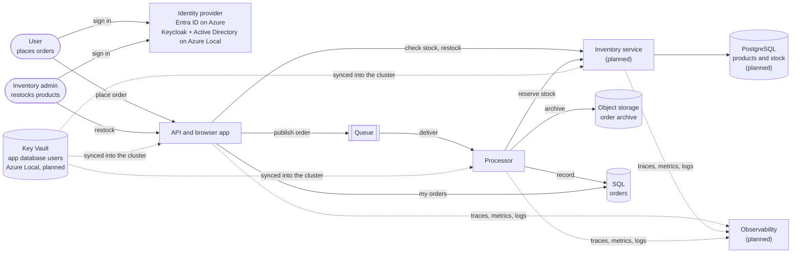

# Order Management App: design

The app shows how an app written for Azure runs unchanged on Azure Local, and keeps working when the
site loses its link to Azure. This page describes the resources on each platform, the production
patterns each one follows, and what's still missing. It also covers the next scope: inventory on
PostgreSQL, Key Vault for the site's database credentials, and observability.

Status: **Built** is in `main` and tested on both platforms. **Planned** is the next scope.

## Architecture

Users in the order group place and list their orders. Users in the inventory admin group restock
products (planned). The processor reserves stock for each order; an order without stock ends as
"Rejected: out of stock" (planned).

## Resources

| Resource | Azure | Azure Local | Status |
|---|---|---|---|
| Cluster | AKS, 2 nodes | AKS enabled by Arc: 1 control plane and 2 worker nodes | Built |
| Images and Recipes | Azure Container Registry | ACR connected registry inside the cluster, synced from ACR | Built |
| HTTPS address | Managed NGINX ingress, Let's Encrypt certificate | NGINX ingress on the Arc load balancer, site CA certificate renewed by cert-manager | Built |
| User sign-in | Entra ID | Keycloak (PostgreSQL behind it), federated to Active Directory | Built |
| Queue | Service Bus Standard | RabbitMQ container | Built |
| SQL | Azure SQL Database S0 | SQL Server 2022 container | Built |
| Object storage | Blob Storage, LRS | Azurite container (emulator) | Built |
| API, processor | Containers on the cluster | Same images, same app definition | Built |
| Inventory service | Container on the cluster | Same image, same app definition | Planned |
| PostgreSQL | Azure Database for PostgreSQL Flexible Server | PostgreSQL container | Planned |
| Secrets | None needed: workload identity everywhere | Key Vault, synced into the cluster by the Secret Store extension | Planned |
| Observability | Application Insights | OpenTelemetry Collector, Prometheus with Alertmanager, Loki, Tempo, Grafana | Planned |

## Production patterns by resource

| Resource | In place | Missing for production |
|---|---|---|
| App code | Interfaces separate from implementations; dependency injection; repositories for SQL and storage; adapters for each broker and identity provider. Idempotent processing (SQL `MERGE`, overwrite on archive). Health probes, CPU and memory limits, non-root images. Images deployed by digest. | One replica each; no autoscaling or disruption budget. An order is rejected, not retried, while the queue is down. |
| Identity, Azure | Entra workload identity for every service: no secrets. Service Bus and Blob: only the send, receive or data roles each service needs. | SQL: the app's identity is the server's Entra administrator; it should be a database user that can only read and write its own tables. |
| Identity, Azure Local | Keycloak tokens for the queue, issued for the pod's own Kubernetes identity. Keycloak's AD account: read-only, no groups, sign-in only at domain controllers, listing denied outside the app's OU, LDAPS. | Keycloak and its database run one replica each. SQL uses the `sa` login. Secrets live only in the cluster (planned: Key Vault). |
| Queue | Dead-lettering after 10 failed deliveries on both platforms. Service Bus: local auth disabled, TLS 1.2. RabbitMQ: quorum queue on a persistent volume, StatefulSet. | Single RabbitMQ node; no TLS to RabbitMQ. Service Bus without zone redundancy (needs Premium). |
| SQL | Azure SQL: Entra-only authentication, TLS 1.2, built-in automatic backups. SQL Server: persistent volume, StatefulSet, password rotation script. | Azure SQL: public endpoint with the Azure-services firewall rule; no zone redundancy. SQL Server: Developer edition, which isn't licensed for production; `sa` login; certificate not verified; no backups; single instance. |
| Object storage | Blob: no shared keys, no public access, HTTPS and TLS 1.2 only. | Blob: LRS, no soft delete or versioning. Azure Local: Azurite is an emulator and keeps no data; replace it with a supported object store. |
| Ingress and certificates | Azure: Let's Encrypt. Azure Local: certificates for the app and Keycloak renewed on site by cert-manager, 30 days before expiry, with no restart. | The site CA key needs a backup. Corporate PKI instead of the site CA. |
| Cluster | Azure: Azure RBAC, local accounts disabled. Azure Local: Calico network policy engine enabled; images served from the connected registry, so pods restart offline. | Network policies (none defined). One control plane node on Azure Local. AKS without availability zones or an automatic upgrade channel. Floating tags for SQL Server and RabbitMQ images. |
| Observability | None. | Planned: traces, metrics and logs from the app; dashboards and alerts on both platforms. |

## Planned scope

1. **Inventory on PostgreSQL.** A separate inventory service owns products and stock. Azure: Flexible
   Server with workload identity. Azure Local: PostgreSQL container on a persistent volume. A second
   group, inventory admins, restocks through the app.
2. **Key Vault for the Azure Local database credentials.** The app gets its own least-privilege
   database users for SQL and PostgreSQL, instead of `sa` and the admin account. Their passwords
   live in Key Vault and the Secret Store extension syncs them into the cluster, so they keep
   working offline. Azure needs none: it uses workload identity.
3. **Observability.** The app sends OpenTelemetry to a collector the platform provides. Azure:
   Application Insights. Azure Local: an on-site stack, with alerts on dead-lettered orders, a
   stalled processor, low stock and expiring certificates.

## Open decisions

- **Key Vault on Azure Local:** the Secret Store extension signs in with Arc workload identity,
  which is in preview and can only be enabled when the cluster is created. Enabling it changes the
  cluster's token issuer, which Keycloak uses to accept the app's tokens; that needs testing. The
  extension also installs its own cert-manager, next to the one the connected registry runs.
- **SQL Server licence:** Developer edition for the sample; production needs Standard or Enterprise.
- **High availability:** replicas and clustering for each service, and which SQL Server option keeps
  working offline.
- **Object storage on Azure Local:** which supported store replaces Azurite.
