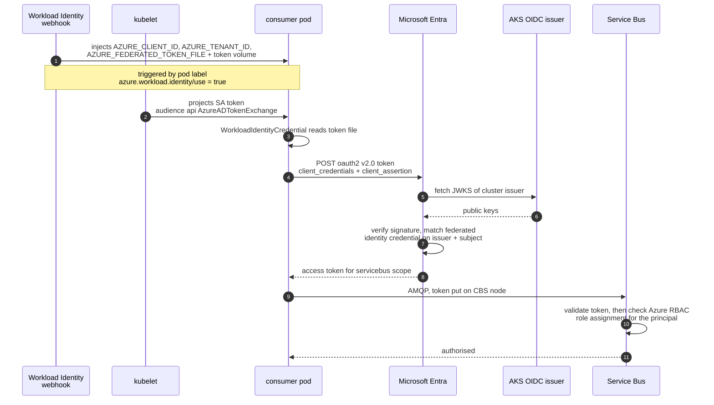
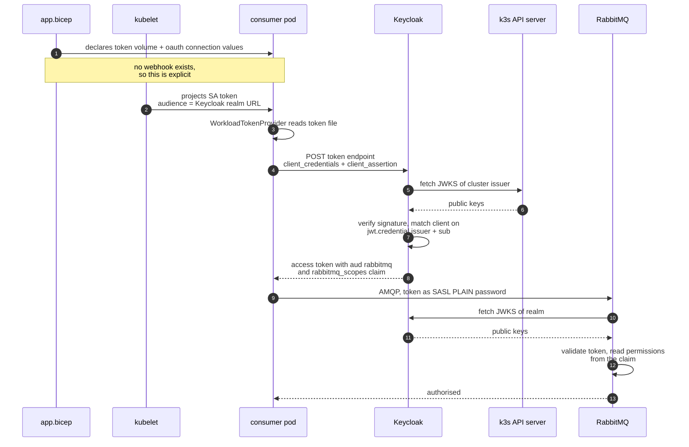
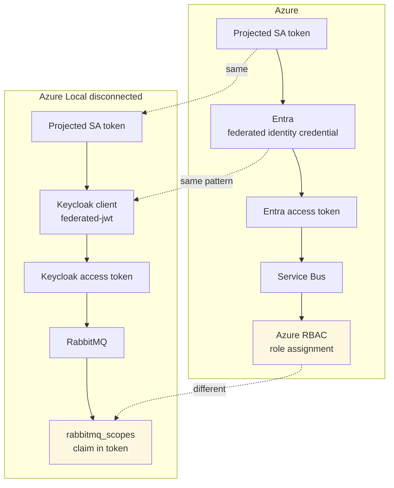
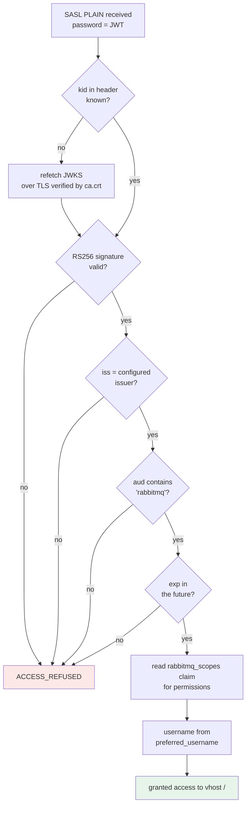

# Workload identity: Azure and Azure Local disconnected

How a worker proves who it is without holding a secret, in each environment.

On AKS the trust anchor is Microsoft Entra. In disconnected operations there is no Entra, so
Keycloak takes its place, federated to the cluster's own token issuer. The mechanism either side is
the same: a token the cluster signs is presented as a *client assertion*, and exchanged for an
access token the backing service accepts.

## The assertion

The assertion is the pod's projected ServiceAccount token. The workload does not create it and
holds no signing key:

1. The kubelet requests a token for a named audience from the API server.
2. The API server signs it with the ServiceAccount signing key.
3. The kubelet writes it into the pod and replaces it before it expires.
4. The application reads the file and forwards it unchanged.

Because a third party signs it, this is `federated-jwt` rather than `private_key_jwt`. No signing
key ever exists in the pod, so there is none to distribute, rotate or leak.

### The file

The kubelet writes it, the application reads it. Nothing else is involved, and the pod cannot ask
for a different audience or a different ServiceAccount's token: both were fixed in the pod spec at
admission.

The file holds a single line of three base64url segments. Measured on a running publisher:

```
bytes: 1114    segments: 3
header 90      payload 680      signature 342
```

The 342-character signature decodes to 256 bytes, which is a 2048-bit RSA signature, consistent
with the `RS256` header and the key published in the cluster JWKS. The signature is part of the
file; there is nothing stored outside it.

The mount is `tmpfs`, so the token never reaches disk, and rotation is atomic: the kubelet writes a
new timestamped directory and swaps a `..data` symlink, so a reader sees either the whole old
version or the whole new one.

```
keycloak -> ..data/keycloak -> ..2026_10_12_05_35_15.1958098714/keycloak
```

### It carries no secret, but it is a credential

Worth separating two things that sound alike.

The *claims* are public facts — issuer, subject, audience, expiry, pod and namespace names. No
password, no symmetric key, no private key. Decoding and publishing the payload would compromise
nothing.

The *token as a whole* is a bearer credential. Whoever holds those bytes is that workload, to that
issuer, until it expires.

| | |
| --- | --- |
| Forge one | No. Needs the API server's signing key. |
| Alter the claims | No. Any change breaks the signature. |
| Replay it verbatim | **Yes**, for up to 600 seconds. |
| Use it against another service | No. `aud` binds it to the Keycloak realm. |

So the advantage over a client secret is not that there is nothing to steal. It is that the
credential is short-lived, bound to one audience, and never written to a Secret, a config file, a
repository or a CI system. A stolen client secret grants impersonation until someone notices; a
stolen assertion grants ten minutes against one issuer.

Treat the file as sensitive. Note also that any process in the pod can read it — the gap that
SPIFFE's process-level attestation closes by never handing out a replayable file.

### Decoded assertion, Azure Local disconnected

Header:

```json
{
  "alg": "RS256",
  "kid": "rT8mPq2vXk9LsYw4Nf6Hc1ZbGj3Ad5Ue",
  "typ": "JWT"
}
```

Payload:

```json
{
  "iss": "https://10.0.60.50:6443",
  "sub": "system:serviceaccount:bcd-aldo:bcd-workload",
  "aud": ["https://10.0.60.50:30443/realms/bcd"],
  "exp": 1791830400,
  "iat": 1791829800,
  "kubernetes.io": {
    "namespace": "bcd-aldo",
    "node": { "name": "bcd" },
    "pod": { "name": "publisher-848b9cfb54-kznbz" },
    "serviceaccount": { "name": "bcd-workload" }
  }
}
```

The values above are illustrative; the claim shape is real.

Three claims carry the whole design. `iss` names the cluster that vouched for the pod. `sub`
identifies the ServiceAccount, and is what the issuer pins the client to. `aud` binds the token to
one recipient, so a leaked assertion cannot be replayed against the Kubernetes API server or any
other service.

The equivalent on AKS differs only in those same three claims:

```json
{
  "iss": "https://eastus.oic.prod-aks.azure.com/<tenant-id>/<cluster-id>/",
  "sub": "system:serviceaccount:bcd:bcd-workload",
  "aud": ["api://AzureADTokenExchange"]
}
```

### The access token returned

What Keycloak issues in exchange, and what RabbitMQ receives as its AMQP password:

```json
{
  "iss": "https://10.0.60.50:30443/realms/bcd",
  "aud": ["rabbitmq", "minio", "account"],
  "sub": "f4c1b8e2-9a7d-4c3e-b6f1-2d8a5e0c7b94",
  "typ": "Bearer",
  "azp": "bcd-workloads",
  "preferred_username": "service-account-bcd-workloads",
  "rabbitmq_scopes": "rabbitmq.configure:*/* rabbitmq.write:*/* rabbitmq.read:*/*",
  "exp": 1791830700,
  "iat": 1791829800
}
```

Note that authorisation travels inside the token. RabbitMQ keeps no user record for this workload.

## Azure: AKS pod to Service Bus



## Azure Local disconnected: k3s pod to RabbitMQ



## The structural parallel



## What RabbitMQ checks



## Mapping

| Concept | Azure | Azure Local disconnected |
| --- | --- | --- |
| Trust anchor | Microsoft Entra | Keycloak |
| Federated on | AKS OIDC issuer | k3s API server issuer |
| Identity object | User-assigned managed identity | Client `bcd-workloads` |
| Pinning | Federated identity credential (issuer + subject) | `jwt.credential.issuer` + `jwt.credential.sub` |
| Assertion audience | `api://AzureADTokenExchange` | `https://10.0.60.50:30443/realms/bcd` |
| Environment wiring | Mutating admission webhook | Declared in `deploy/app.bicep` |
| Client library | `Azure.Identity` | `src/Bcd.Shared/Identity/WorkloadTokenProvider.cs` |
| Token to broker | AMQP CBS node | SASL PLAIN password |
| Authorisation | Azure RBAC, outside the token | Claims inside the token |

The first rows are the same mechanism under different names: both are RFC 7523 client assertions
federated on the cluster's OIDC issuer.

The last row is the one real architectural difference. Azure RBAC is consulted per request, so
revoking a role takes effect at once. A claim baked into a token keeps its rights until the token
expires, which is 15 minutes here. Shortening `access.token.lifespan` narrows that window at the
cost of more traffic to the token endpoint.

## Configuration reference

| Where | Setting | Value |
| --- | --- | --- |
| k3s | `--service-account-issuer` | `https://10.0.60.50:6443` |
| `deploy/app.bicep` | token volume audience | `https://10.0.60.50:30443/realms/bcd` |
| Keycloak identity provider | `issuer` | `https://10.0.60.50:6443` |
| Keycloak client | `clientAuthenticatorType` | `federated-jwt` |
| Keycloak client | `jwt.credential.sub` | `system:serviceaccount:bcd-aldo:bcd-workload` |
| RabbitMQ | `auth_oauth2.issuer` | `https://10.0.60.50:30443/realms/bcd` |
| RabbitMQ | `auth_oauth2.resource_server_id` | `rabbitmq` |
| RabbitMQ | `auth_oauth2.additional_scopes_key` | `rabbitmq_scopes` |
| RabbitMQ | `auth_oauth2.https.cacertfile` | `/etc/rabbitmq/oauth-ca/ca.crt` |

## Failure modes seen while building this

Both failures were in *fetching public keys*, never in the verification itself. A "signature
invalid" symptom is more often a key-retrieval problem than a bad token.

| Symptom | Cause |
| --- | --- |
| Keycloak reports signature validation failure | The k3s API server refuses anonymous callers. Keycloak needs a ClusterRoleBinding granting `system:service-account-issuer-discovery` to its own ServiceAccount. |
| `Bad Certificate - selfsigned_peer` in the broker log | Erlang requires a trust anchor to be a real CA. A self-signed serving certificate cannot anchor itself, so Keycloak is issued a certificate from a small CA instead. |
| `client_not_found` from Keycloak | `federated-jwt` was absent from the realm's `clients` authentication flow. Realms created before Keycloak 26.8 and then migrated do not gain it. |
| Broker logs stop appearing in `kubectl logs` | Mounting a ConfigMap over `/etc/rabbitmq/conf.d` replaces the image's defaults, including console logging. The recipe restores `log.console = true`. |

## Scope

This covers the queue only. SQL Server and object storage still use credentials, because neither
exposes a configurable token issuer:

| Resource | Can verify | Result |
| --- | --- | --- |
| RabbitMQ | OIDC bearer tokens | Secretless |
| SQL Server on Linux | SQL login or Kerberos | Password, or a keytab |
| Azurite | Shared key | Connection string |

That is a property of what each resource can consume, not a gap in the identity design. The SQL
password path re-reads its credential per connection, so a vault can rotate it under a running
worker without a restart.
